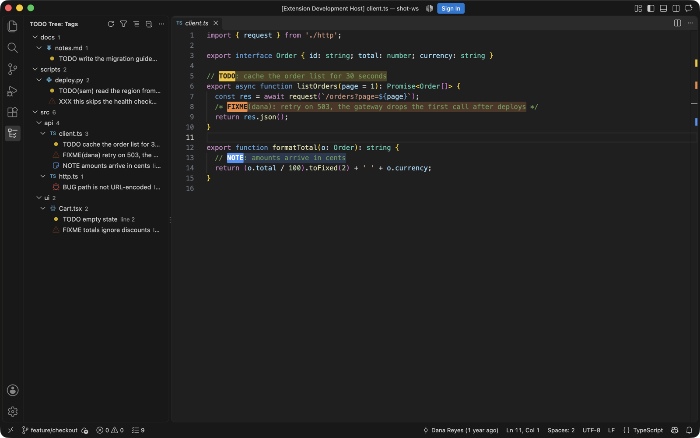

# TODO Tree & FIXME Highlighter

TODO tree for VS Code: every TODO, FIXME, BUG, HACK, XXX and NOTE comment of your workspace in one tree, and colored highlights in the editor. It scans with its own built-in reader, so there is nothing to install and nothing to set up.



## Free, with no sign-in and no network

- Highlights tags inside comments in 60+ languages (`//`, `#`, `/* */`, `<!-- -->`, `--`, `;`, `%` and more), plus `TODO:` lines in Markdown and text notes.
- A tree of every tag, grouped by folder, by file or by tag, with counts. Click a row to jump to the line.
- Built-in scanner: no ripgrep, no extra binary. It skips what `.gitignore` and `files.exclude` hide, large files and binary files.
- Updates as you type and on save, and when files change on disk (git pull, branch switch).
- Owners: `TODO(anna): ...` and `TODO @anna ...` show the owner.
- Filter the tree by text, tag, owner or path. Tag count in the status bar.
- Your own tags and colors, and four highlight styles (tag and text, tag only, whole line, none).

## Pro tools

Zovo Pro: USD 19 once, for the Pro tools of every Zovo extension. Each tool has 3 free tries first, with no account.

- Export TODO report: Markdown, CSV or HTML with the git author and the date each tag was added.
- TODOs changed on this branch: the tags your branch added or removed against main, uncommitted edits included, ready to paste in a pull request.
- Find stale TODOs: tags older than 90 days (you set the age), oldest first and grouped by person, with a JSON file for CI.

## How to use

1. Open a folder. The TODO Tree icon in the Activity Bar shows the tags of the workspace.
2. Open any file: tags in comments are highlighted.
3. Use the buttons at the top of the tree to rescan, filter or change the grouping (folder, file, tag).

Comments the scanner understands:

```ts
// TODO: cache the response
/* FIXME(anna): this leaks the socket on timeout */
# HACK @bob work around the old API
<!-- NOTE: keep in sync with the docs -->
```

In Markdown and plain text files a tag counts at the start of a line or a list item, such as `- TODO: write the intro`.

## Settings

| Setting | Default | What it does |
| --- | --- | --- |
| `zovoTodo.tags` | TODO, FIXME, BUG, HACK, XXX, NOTE | The tags to find. Add your own, like REVIEW or PERF. |
| `zovoTodo.tagColors` | built in | Background and foreground per tag. |
| `zovoTodo.highlight` | `text` | `text`, `tag`, `line` or `none`. |
| `zovoTodo.groupBy` | `folder` | `folder`, `file` or `tag`. |
| `zovoTodo.commentsOnly` | `true` | Turn off to find tags anywhere in a line. |
| `zovoTodo.caseSensitive` | `true` | Turn off to also match `todo`. |
| `zovoTodo.exclude` | dist, out, build, coverage, vendor, .next | More globs to skip. |
| `zovoTodo.useGitignore` | `true` | Skip what `.gitignore` lists. |
| `zovoTodo.maxFiles` | 20000 | Stop the scan after this many files. |
| `zovoTodo.maxFileSizeKB` | 512 | Skip larger files. |

## Privacy

The extension reads files on your computer and nothing else. It makes no network requests and has no telemetry. The Pro tools run your local `git` (blame and diff) and write files only where you choose.

## Known limits

- The workspace tree lists folders on disk. In a remote or virtual workspace without a local file system, highlights work but the tree stays empty.
- A tag inside a string literal that looks like a comment (for example `"// TODO"`) can count as a tag in a few languages.
- Only one tag per line is listed: the first one inside a comment.

## Support Zovo

Zovo Pro: USD 19 once, every Zovo viewer. [Get Zovo Pro on GitHub Sponsors](https://github.com/sponsors/theluckystrike/sponsorships?tier_id=679878) to turn on the Pro tools in this extension and in the other Zovo extensions you use. The free features stay free.

Zovo extensions have no ads and no tracking. They are made by [theluckystrike](https://github.com/theluckystrike) on GitHub. You can also support the work with no Pro:

- [Sponsor on GitHub](https://github.com/sponsors/theluckystrike)
- [PayPal](https://www.paypal.com/paypalme/najzzz)
- [Follow theluckystrike on GitHub](https://github.com/theluckystrike)

### Need your format supported?

Open a [format request](https://github.com/theluckystrike/todo-tree-vscode/issues/new?template=format-request.yml) with a sample file, and I reply there whether it can be done. For USD 299 once, through [this GitHub Sponsors tier](https://github.com/sponsors/theluckystrike/sponsorships?tier_id=679995), I add your file format or a missing feature to this extension, with tests, within 7 days.

## More tools by Zovo

- [PDF Viewer & PDF Reader to Read and View PDF (Dark Mode)](https://marketplace.visualstudio.com/items?itemName=zovo.pdf-viewer-dark) reads PDFs with a real dark mode, search, an outline and thumbnails.
- [XLSX Viewer, Excel Viewer, CSV Viewer & Parquet Viewer (XLS, CSV Preview)](https://marketplace.visualstudio.com/items?itemName=zovo.table-viewer-vscode) opens CSV, TSV, Excel and Parquet files as a sortable, filterable table.
- [DOCX Viewer & ODT Viewer, Word Document Preview (Dark Mode)](https://marketplace.visualstudio.com/items?itemName=zovo.docx-viewer-vscode) previews Word and ODT files with dark mode, an outline and search.

See [all Zovo extensions on the Marketplace](https://marketplace.visualstudio.com/publishers/zovo).
